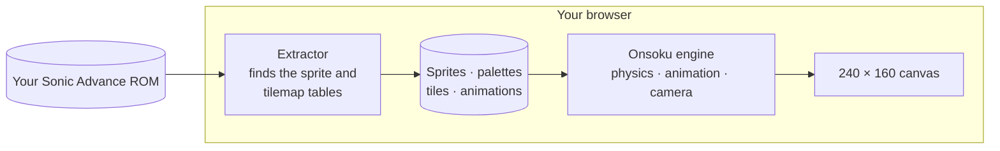
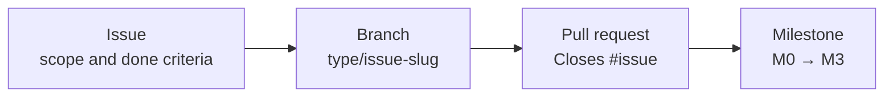

 
 

**A from-scratch front-end port of Sonic Advance for the Game Boy Advance.** 
No emulator and no game files in this repository: your own ROM, read on your machine, brought to life in the browser.

 

 

[Overview](#overview) &nbsp;·&nbsp; [Status](#status) &nbsp;·&nbsp; [How it works](#how-it-works) &nbsp;·&nbsp; [Getting started](#getting-started) &nbsp;·&nbsp; [Roadmap](#roadmap) &nbsp;·&nbsp; [Contributing](#contributing) &nbsp;·&nbsp; [Legal](#legal)

 

## Overview

*Onsoku* (音速) is Japanese for **"speed of sound"**. Onsoku Advance rebuilds Sonic Advance as a modern web app: the game logic is written from scratch in JavaScript and drawn on a canvas, while the graphics, palettes and level data come from the ROM you own, decoded on your machine.

<table>
<tr>
<td width="50%" valign="top">

**⚡ No emulation** 
The original machine code never runs. Movement, animation and camera are reimplemented as plain JavaScript that any modern browser runs natively.

</td>
<td width="50%" valign="top">

**🎮 Bring your own ROM** 
Nothing from the game is stored here. Sprites, palettes and tiles are extracted from your own copy, in your browser, and never uploaded.

</td>
</tr>
<tr>
<td width="50%" valign="top">

**🎯 Faithful by design** 
Physics constants, animation timing and camera rules follow the original game, as documented by the community decompilation.

</td>
<td width="50%" valign="top">

**🔍 Pixel-perfect** 
Native 240 × 160 output, scaled up in whole steps so every pixel stays sharp on any screen.

</td>
</tr>
</table>

## Status

> [!NOTE]
> **Pre-alpha: there is nothing to play in this repository yet.** A working movement prototype exists and moves in with [M1 — Playable prototype](https://github.com/NahuelGenchi/onsoku-advance/milestone/2): Sonic on a Neo Green Hill platform with the original walking, running, braking, turning, crouching, looking up, jumping, rolling and spin dash, and the original camera.

| Area | State | Tracked in |
| :--- | :--- | :--- |
| ROM extractor: sprites, palettes, tiles | 🟡 Prototype, moving in | [#4](https://github.com/NahuelGenchi/onsoku-advance/issues/4) |
| Movement, animations and camera | 🟡 Prototype, moving in | [#5](https://github.com/NahuelGenchi/onsoku-advance/issues/5) |
| Stage maps and collision | ⚪ Planned | [M2](https://github.com/NahuelGenchi/onsoku-advance/milestone/3) |
| Rings, objects and enemies | ⚪ Planned | [M2](https://github.com/NahuelGenchi/onsoku-advance/milestone/3) |
| Sound and music | ⚪ Planned | [M2](https://github.com/NahuelGenchi/onsoku-advance/milestone/3) |
| Hosted build and releases | ⚪ Planned | [M3](https://github.com/NahuelGenchi/onsoku-advance/milestone/4) |

## How it works

1. **Extract.** You pick your ROM. The extractor locates the game's sprite and tilemap tables and decodes frames, palettes, tiles and animation scripts into memory. It is designed to run entirely in the browser: the ROM is read locally and nothing is uploaded.
2. **Simulate.** The engine steps 60 times per second with the original game's rules: acceleration, braking, gravity, jump height, roll friction, spin dash speeds and the camera's dead zones.
3. **Draw.** Sprites and layers are composed at the Game Boy Advance's own 240 × 160 resolution, including the per-line background scrolling the original uses for its sea and clouds.

## Getting started

Playable builds arrive with [M1 — Playable prototype](https://github.com/NahuelGenchi/onsoku-advance/milestone/2). You will need:

- A current desktop browser
- Your own Sonic Advance ROM, dumped from a cartridge you own

Supported ROM versions will be listed here, identified by checksum.

<b>Controls in the prototype</b>

 

| Action | Keyboard |
| :--- | :--- |
| Run | <kbd>←</kbd> <kbd>→</kbd> or <kbd>A</kbd> <kbd>D</kbd> |
| Jump | <kbd>Z</kbd> or <kbd>Space</kbd> |
| Crouch, or roll while moving | <kbd>↓</kbd> |
| Spin dash | <kbd>↓</kbd> + <kbd>Z</kbd> |
| Look up | <kbd>↑</kbd> |

On touch screens, on-screen buttons appear instead.

## Roadmap

| Milestone | Outcome | Progress |
| :--- | :--- | :--- |
| [M0 — Project foundation](https://github.com/NahuelGenchi/onsoku-advance/milestone/1) | Repository, documentation, tracking and presentation |  |
| [M1 — Playable prototype](https://github.com/NahuelGenchi/onsoku-advance/milestone/2) | Sonic on a Neo Green Hill platform, assets from your own ROM |  |
| [M2 — Stages and gameplay](https://github.com/NahuelGenchi/onsoku-advance/milestone/3) | Full stages with collision, rings, objects, enemies, sound and music |  |
| [M3 — Release](https://github.com/NahuelGenchi/onsoku-advance/milestone/4) | A hosted build and versioned releases, with no game files |  |

## Contributing

Every change follows one trail: **issue → branch → milestone → pull request**.

Read [CONTRIBUTING.md](CONTRIBUTING.md) and [docs/TRACKING.md](docs/TRACKING.md) before opening work. Bugs and ideas start as an [issue](https://github.com/NahuelGenchi/onsoku-advance/issues/new/choose). Never attach ROMs, save files or extracted game assets.

## Acknowledgements

- The [SAT-R](https://github.com/SAT-R) decompilation of Sonic Advance, the reference for the game's data formats, physics and camera behavior. None of its code or data is copied into this repository.

## Legal

Onsoku Advance is an unofficial fan project and is not affiliated with or endorsed by SEGA or Sonic Team. Sonic Advance and all related names, characters and assets belong to SEGA. This repository contains no copyrighted game assets: you need your own legally obtained ROM, and its graphics and sounds are extracted locally on your machine.

The project's own code, documentation and artwork are licensed under [GPL-3.0-or-later](LICENSE).

 

Built by <a href="https://github.com/NahuelGenchi">Nahuel Genchi</a> &nbsp;·&nbsp; 音速

