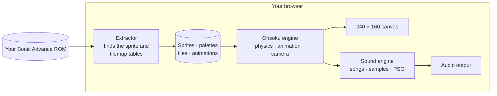
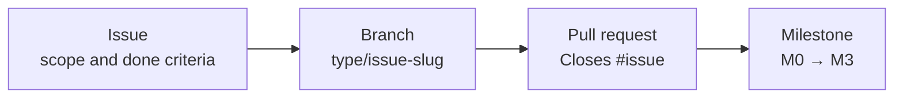

<div align="center">

# Onsoku Advance

### Sonic Advance, rebuilt to play in your web browser.

Nothing to install. Bring your own copy of the game; it never leaves your device.

<br>

<a href="https://nahuelgenchi.github.io/onsoku-advance/"></a>

<sub>Neo Green Hill Zone, act 1, in the optional widescreen view. Every clip on this page is a recording of Onsoku Advance itself.</sub>

<br>

<a href="https://nahuelgenchi.github.io/onsoku-advance/"></a>

<br>

[What is it?](#what-is-it) &nbsp;·&nbsp; [How to play](#play-in-three-steps) &nbsp;·&nbsp; [Moves](#what-sonic-can-do) &nbsp;·&nbsp; [Extras](#extras-you-can-switch-on) &nbsp;·&nbsp; [Controls](#controls) &nbsp;·&nbsp; [Progress](#where-its-at) &nbsp;·&nbsp; [Questions](#questions)

</div>

<br>

## What is it?

Onsoku Advance lets you play **Sonic Advance**, Sonic's 2001 adventure for the Game Boy Advance, in a web browser.

It isn't an emulator (a program that imitates a Game Boy Advance). Instead, the game has been rebuilt piece by piece, so that Sonic runs, jumps and rolls the way he does on the cartridge. The pictures, levels, music and sounds come from **your own copy of the game**: you open your Sonic Advance file on the game's page, and Onsoku Advance reads everything it needs from it, right there on your device.

*Onsoku* (音速) is Japanese for "speed of sound".

<table>
<tr>
<td width="33%" valign="top">

🎮 **True to the original**<br>
Same physics, same timing, same camera and the game's own sound engine, checked against the original game frame by frame.

</td>
<td width="33%" valign="top">

🔒 **Private by design**<br>
Your game file is opened on your device and stays there. Nothing from it is ever uploaded.

</td>
<td width="33%" valign="top">

⚡ **Nothing to install**<br>
Open the page, choose your file and play, with a keyboard, an Xbox controller or on-screen touch buttons.

</td>
</tr>
</table>

## Play in three steps

1. **Open the game** at **[nahuelgenchi.github.io/onsoku-advance](https://nahuelgenchi.github.io/onsoku-advance/)** in a current desktop browser.
2. **Choose your Sonic Advance file**, the `.gba` file copied from your cartridge (called a *ROM*). The game starts right away. Tick *Remember this ROM on this device* to skip this step next time.
3. **Play.** The [controls](#controls) are below, and <kbd>H</kbd> shows them during the game.

> [!TIP]
> **Where does the file come from?** From a Sonic Advance cartridge you own, copied to your computer with a cartridge reader. This project can't provide the game. Sonic Advance (USA) is the tested version; [docs/ROM.md](docs/ROM.md) has the details.

## What Sonic can do

All of this works today. Each clip was played and recorded in Onsoku Advance, in Neo Green Hill Zone act 1.

<table>
<tr>
<td width="50%" valign="top">

<br>
<b>Spin dash</b><br>
Crouch, rev up and let go to blast off from a standstill.<br>
<kbd>↓</kbd> + <kbd>Z</kbd>
</td>
<td width="50%" valign="top">

<br>
<b>Insta-shield and mid-air dash</b><br>
Press jump again in the air for a flash of shield, or tap a direction twice to dash.<br>
<kbd>Z</kbd> in the air &nbsp;·&nbsp; <kbd>→</kbd> <kbd>→</kbd> in the air
</td>
</tr>
<tr>
<td width="50%" valign="top">

<br>
<b>Spin, kick, then slide or backflip</b><br>
The attack button chains three moves together on the ground.<br>
<kbd>X</kbd> <kbd>X</kbd> then <kbd>X</kbd> or <kbd>Z</kbd>
</td>
<td width="50%" valign="top">

<br>
<b>Bop the robots</b><br>
Land on an enemy to break it open and free the animal trapped inside.<br>
<kbd>Z</kbd> to jump on it
</td>
</tr>
<tr>
<td width="50%" valign="top">

<br>
<b>Item boxes</b><br>
Break one open for rings, a shield, invincibility, speed shoes or an extra life.<br>
<kbd>↓</kbd> while running to roll into it
</td>
<td width="50%" valign="top">

<br>
<b>Rings</b><br>
Collect them as you run. Take a hit and they scatter, so grab what you can. 100 rings earn an extra life.
</td>
</tr>
<tr>
<td width="50%" valign="top">

<br>
<b>Wall poles</b><br>
Grab a pole on a cliff face and get swung up to the next one.
</td>
<td width="50%" valign="top">

<br>
<b>Half-pipe</b><br>
Hit it at speed and Sonic races up and around its curved wall.
</td>
</tr>
</table>

Act 1 also has its loops, springs, spikes, grind rails, speed boosters, checkpoints, a trampoline, swinging, falling and crumbling platforms, bounce blocks, boulders, waterfalls, an incline ramp and a forced slide, all working as in the original.

## True to the cartridge

<div align="center">

</div>

The goal is a game that behaves *exactly* like the original, not one that looks roughly like it.

- **Rules from the source.** Sonic's speed, jumps and rolls, the camera and every object follow the original game's rules, as worked out by [SAT-R](https://github.com/SAT-R), the community project that turned Sonic Advance's program back into readable code.
- **Checked against the real thing.** The results are compared with the original game running in an emulator. Even the original's own bugs are kept, so the two match; they are [listed](https://github.com/NahuelGenchi/onsoku-advance/issues/56) for an optional fix later.
- **The game's own sound.** The music and sound effects are played by a rebuilt copy of the cartridge's sound engine, whose output matches the original's byte for byte.
- **Sharp pixels.** The game draws at the Game Boy Advance's own 240 × 160 and scales up in whole steps, so every pixel stays crisp on any screen.

The act opens, and starts over after a lost life, with the original title card sliding in as the screen fades up from black. The original on-screen counters show your rings, score, time and lives.

## Extras you can switch on

Two optional additions on top of the original game. Both are off until you turn them on, and with them off the game runs exactly as without them.

### Widescreen view

<div align="center">

</div>

See more of the act around the original screen, up to 368 × 208, filling the window at the same whole-step scale. The outline marks the Game Boy Advance's screen: the game plays exactly as it does there. Press <kbd>V</kbd> or use the *Widescreen* button in the help panel.

### Sonic Rush boost

<div align="center">

</div>

The boost from *Sonic Rush* on the Nintendo DS. Hold the boost button and Sonic blasts ahead at top speed, wrapped in Rush's blue aura and trail, smashing enemies, boulders and item boxes on contact, while nothing can hurt him. Press <kbd>R</kbd> or use the *Rush boost* button to turn it on, then hold <kbd>L</kbd> or <kbd>Shift</kbd> (<kbd>X</kbd> on a controller) to boost.

Its look and sound are Sonic Rush's own, so it also needs your **Sonic Rush ROM** (`.nds`). It's asked for the first time you turn the boost on and, like the Sonic Advance file, read and kept on your device only. Its rules were read from Sonic Rush (USA) and checked in an emulator. For now it has no limit: Sonic Rush's tension gauge, which the boost uses up, isn't built yet.

<details>
<summary><b>How the boost works, in detail</b></summary>
<br>

- **Start.** Press the boost button while standing or running on the ground (not curled up, attacking or on a
  grind rail). Sonic turns to the direction held and runs at least 12 px a frame that way at once, with Sonic
  Rush's boost sound and a short screen shake.
- **While held.** Rush's own movement rules replace Sonic Advance's: on the ground the top speed is 12, a little
  more on slopes, with an acceleration of 48/256 that fades out as he nears it; holding the other way brakes by
  80/256, and holding nothing slows him by 80/256 on floors. He keeps boosting through jumps, where holding a
  direction keeps his speed with no air drag and holding nothing slows him down. A box 64 px square around him
  destroys enemies and breaks boulders and item boxes, without bouncing him, and shakes the screen each time;
  nothing can hurt him.
- **End.** Letting go of the button ends it, and so does moving less than 6 px a frame on the ground for more
  than 8 frames in a row (running into a wall, say). The next boost can start 8 frames later. Afterwards the
  original rules take over, so he keeps the speed he has until he slows down.
- **Camera.** As in Sonic Rush, the view falls behind him for the first 8 frames, then moves ahead of him by up
  to 88 px in the direction he runs, and eases back once the boost is over.
- **Look.** The burst at the start, the aura around Sonic and the blue trail behind him are Sonic Rush's, from
  its sprites and its trail effect, placed, rotated, layered and blended the way the DS draws them: the sprites
  through its rotation hardware and half transparent, the trail as translucent 3D polygons under them.
- **Sound.** The boost's sound effect is played from Sonic Rush's sound archive by a port of the DS sound engine
  (the sequencer, its channels and the sound hardware), which matches Sonic Rush in an emulator frame by frame.
  It plays on top of the original game's sound at the same full volume, the two consoles' outputs matched.

Where the port differs from the DS: the trail's polygons are not clipped at the screen's edges before they are
drawn, and Sonic Advance's own sprites behind Sonic count as background when the boost's sprites blend over them.

</details>

## Controls

| | Keyboard | Xbox controller |
| :--- | :--- | :--- |
| **Run** | <kbd>←</kbd> <kbd>→</kbd> or <kbd>A</kbd> <kbd>D</kbd> | D-pad or left stick |
| **Jump** | <kbd>Z</kbd> or <kbd>Space</kbd> | <kbd>A</kbd> |
| **Insta-shield** | <kbd>Z</kbd> again in a jump, once the rise slows | <kbd>A</kbd> again |
| **Mid-air dash** | Tap <kbd>←</kbd> <kbd>←</kbd> or <kbd>→</kbd> <kbd>→</kbd> in a jump | Tap left twice or right twice |
| **Attack:** spin, then kick, then slide or backflip | <kbd>X</kbd>, <kbd>X</kbd>, then <kbd>X</kbd> or <kbd>Z</kbd> | <kbd>B</kbd> or <kbd>X</kbd> (only <kbd>B</kbd> with the Rush boost on), again, then again or <kbd>A</kbd> |
| **Crouch**, or **roll** while moving | <kbd>↓</kbd> | Down |
| **Spin dash** | <kbd>↓</kbd> + <kbd>Z</kbd> | Down + <kbd>A</kbd> |
| **Look up** | <kbd>↑</kbd> | Up |
| **Boost**, with the [Rush boost](#sonic-rush-boost) on | <kbd>L</kbd> or <kbd>Shift</kbd> | <kbd>X</kbd> |
| Help panel on or off | <kbd>H</kbd> | |
| Sound on or off | <kbd>M</kbd> | |
| Widescreen view on or off | <kbd>V</kbd> | |
| Rush boost on or off | <kbd>R</kbd> | |
| Show the collision (for checking the level) | <kbd>C</kbd> | |

Other controllers that your browser maps to the Xbox layout work the same way. Press a button once after the page loads so the browser notices the controller. On touch screens, on-screen buttons appear instead.

## Where it's at

> [!NOTE]
> **Early days: the first act is playable.** You can play all of **Neo Green Hill Zone act 1**, with its music, sounds, rings, enemies, item boxes and every one of its gadgets. The act has no ending yet (no goal signpost or score tally), and there is no game over yet.
>
> **Angel Island Zone act 2** starts with `?level=9` added to the page's address. Its boss, Mecha Knuckles, fights in both its phases, covers up, fires its rocket and falls apart as in the original, and the act's tubes, hang bars, spiked platforms, hidden springs, steep booster and mud slides work. The zone's other objects are still placeholders.

Here's the road through the rest of the game. Each step has its own issue, so you can follow along.

<table>
<thead>
<tr><th align="left">Zone</th><th align="left">Act 1</th><th align="left">Act 2 and boss</th></tr>
</thead>
<tbody>
<tr><td><b>Neo Green Hill</b></td><td>🟢 Playable now<br><sub>Next up: <a href="https://github.com/NahuelGenchi/onsoku-advance/issues/69">its ending, then on to act 2</a></sub></td><td>⚪ <a href="https://github.com/NahuelGenchi/onsoku-advance/issues/83">Act 2 and the Egg Hammer Tank</a></td></tr>
<tr><td><b>Secret Base</b></td><td>⚪ <a href="https://github.com/NahuelGenchi/onsoku-advance/issues/79">Planned</a></td><td>⚪ <a href="https://github.com/NahuelGenchi/onsoku-advance/issues/73">Act 2 and the Egg Press</a></td></tr>
<tr><td><b>Casino Paradise</b></td><td>⚪ <a href="https://github.com/NahuelGenchi/onsoku-advance/issues/81">Planned</a></td><td>⚪ <a href="https://github.com/NahuelGenchi/onsoku-advance/issues/76">Act 2 and the Egg Ball</a></td></tr>
<tr><td><b>Ice Mountain</b></td><td>⚪ <a href="https://github.com/NahuelGenchi/onsoku-advance/issues/71">Planned</a></td><td>⚪ <a href="https://github.com/NahuelGenchi/onsoku-advance/issues/72">Act 2 and the Egg Spider</a></td></tr>
<tr><td><b>Angel Island</b></td><td>⚪ <a href="https://github.com/NahuelGenchi/onsoku-advance/issues/77">Planned</a></td><td>🟡 <a href="https://github.com/NahuelGenchi/onsoku-advance/issues/80">Act 2 and Mecha Knuckles</a><br><sub>The boss and the act's own objects, with <code>?level=9</code></sub></td></tr>
<tr><td><b>Egg Rocket</b></td><td colspan="2">⚪ <a href="https://github.com/NahuelGenchi/onsoku-advance/issues/78">Planned</a></td></tr>
<tr><td><b>Cosmic Angel</b></td><td colspan="2">⚪ <a href="https://github.com/NahuelGenchi/onsoku-advance/issues/74">The zone and the Egg Snake</a></td></tr>
<tr><td><b>X Zone</b></td><td colspan="2">⚪ <a href="https://github.com/NahuelGenchi/onsoku-advance/issues/82">Its three bosses and the normal ending</a></td></tr>
<tr><td><b>Moon Zone</b></td><td colspan="2">⚪ <a href="https://github.com/NahuelGenchi/onsoku-advance/issues/85">The Super Egg Robo and the true ending</a></td></tr>
</tbody>
</table>

Also on the way: the [SEGA and Sonic Team logos and the intro](https://github.com/NahuelGenchi/onsoku-advance/issues/67), the [title screen and main menu](https://github.com/NahuelGenchi/onsoku-advance/issues/70), the [special stages](https://github.com/NahuelGenchi/onsoku-advance/issues/75) and [Chao Hunt multiplayer](https://github.com/NahuelGenchi/onsoku-advance/issues/84), plus two more optional extras from Sonic Advance 2: its [Boost Mode](https://github.com/NahuelGenchi/onsoku-advance/issues/63) and its [mid-air tricks](https://github.com/NahuelGenchi/onsoku-advance/issues/65).

<details>
<summary><b>Milestones</b></summary>
<br>

| Milestone | Outcome | Issues closed |
| :--- | :--- | :--- |
| [M0 — Project foundation](https://github.com/NahuelGenchi/onsoku-advance/milestone/1) | Repository, documentation, tracking and presentation |  |
| [M1 — Playable prototype](https://github.com/NahuelGenchi/onsoku-advance/milestone/2) | Sonic on a Neo Green Hill platform, assets from your own ROM |  |
| [M2 — Stages and gameplay](https://github.com/NahuelGenchi/onsoku-advance/milestone/3) | Full stages with collision, rings, objects, enemies, sound and music |  |
| [M3 — Release](https://github.com/NahuelGenchi/onsoku-advance/milestone/4) | A hosted build and versioned releases, with no game files |  |

The game is [live on GitHub Pages](https://nahuelgenchi.github.io/onsoku-advance/); versioned releases are planned.

</details>

## Questions

<details>
<summary><b>Is this an emulator?</b></summary>
<br>

No. An emulator imitates the Game Boy Advance and runs the cartridge's original program. Onsoku Advance never runs that program: the game's rules have been written again from scratch in JavaScript, the language of web pages, and only the pictures, levels, music and sounds are read from your copy of the game.

</details>

<details>
<summary><b>Where do I get a Sonic Advance ROM?</b></summary>
<br>

From a Sonic Advance cartridge you own, copied to your computer with a cartridge reader (this is often called *dumping* it). This project doesn't provide the game and can't point you to copies of it.

</details>

<details>
<summary><b>Is my game file uploaded anywhere?</b></summary>
<br>

No. The page reads it inside your browser and never sends it anywhere. If you tick *Remember this ROM on this device*, it's kept in your browser's storage on that device only, and *Forget the saved ROM* removes it again. The same goes for the Sonic Rush ROM.

</details>

<details>
<summary><b>Which version of Sonic Advance works?</b></summary>
<br>

**Sonic Advance (USA)** is the tested version. Other versions are recognized from their cartridge header, and the game searches them for what it needs; the [asset viewer](https://nahuelgenchi.github.io/onsoku-advance/viewer.html) shows whether that worked. [docs/ROM.md](docs/ROM.md) has the list and how to help add a version.

</details>

<details>
<summary><b>Can I play on a phone or tablet?</b></summary>
<br>

It's made for a current desktop browser, with a keyboard or a controller. On touch screens, on-screen buttons appear so you can play by touch.

</details>

<details>
<summary><b>Is there sound?</b></summary>
<br>

Yes: the act's music, the extra-life and invincibility tunes, and the sound effects of Sonic, the rings, the enemies, the item boxes and the act's springs, platforms, boosters, rails and more, all read from your ROM. <kbd>M</kbd> turns the sound on or off.

</details>

<details>
<summary><b>Is this official?</b></summary>
<br>

No. It's an unofficial fan project, not affiliated with or endorsed by SEGA or Sonic Team. See [Legal](#legal).

</details>

## How it works

For the curious: the path from your ROM to the screen and speakers.



1. **Extract.** You pick your ROM. The extractor locates the game's sprite and tilemap tables and decodes frames, palettes, tiles and animation scripts into memory, entirely in the browser.
2. **Simulate.** The engine steps 60 times per second with the original game's rules: acceleration, braking, gravity, jump height, roll friction, spin dash speeds and the camera's dead zones.
3. **Draw.** Sprites and layers are composed at the Game Boy Advance's own 240 × 160 resolution, including the per-line background scrolling the original uses for its sea and clouds. The widescreen view draws up to 368 × 208 around the same screen; the game runs exactly as it does at 240 × 160. The optional [Sonic Rush boost](#sonic-rush-boost) adds its trail and aura around Sonic.
4. **Play.** A port of the game's sound engine runs on its own audio thread. It reads the songs and samples from your ROM, and its mixed output matches the original's byte for byte (see [docs/ROM.md](docs/ROM.md#sound)). The Rush boost's sound plays from your Sonic Rush ROM on a port of the Nintendo DS's sound engine, added to the same output.

## Run it on your own computer

There is no build step. The pages use JavaScript modules, which browsers only load over HTTP, so serve the repository folder with any static file server and open it on `localhost`:

```sh
git clone https://github.com/NahuelGenchi/onsoku-advance.git
cd onsoku-advance
python -m http.server 8000
```

Then open <http://localhost:8000> and choose your ROM to play.

To see everything the extractor decodes, open <http://localhost:8000/viewer.html>: Sonic's, the springs' and the rings' animations playing with their original timing, the sprite atlas, Neo Green Hill Zone act 1 with its collision, and the zone's background.

## Contributing

Every change follows one trail: **issue → branch → milestone → pull request**.



Read [CONTRIBUTING.md](CONTRIBUTING.md) and [docs/TRACKING.md](docs/TRACKING.md) before opening work. Bugs and ideas start as an [issue](https://github.com/NahuelGenchi/onsoku-advance/issues/new/choose). Never attach ROMs, save files or extracted game assets.

## Thanks

- The [SAT-R](https://github.com/SAT-R) decompilation of Sonic Advance, the reference for the game's data formats, physics and camera behavior. None of its code or data is copied into this repository.

## Legal

Onsoku Advance is an unofficial fan project and is not affiliated with or endorsed by SEGA or Sonic Team. Sonic Advance, Sonic Rush and all related names, characters and artwork belong to SEGA.

This repository holds no ROM and no data taken from one: you need your own legally obtained copy of the game, and its graphics and sounds are read from it on your own device. The short clips on this page (in [docs/assets/gameplay](docs/assets/gameplay)) are recordings of Onsoku Advance running, made to show the project; the characters and artwork in them remain SEGA's.

The project's own code, documentation and artwork are licensed under [GPL-3.0-or-later](LICENSE).

<br>

<div align="center">
<sub>Built by <a href="https://github.com/NahuelGenchi">Nahuel Genchi</a> &nbsp;·&nbsp; 音速</sub>
</div>
