<div align="center">

# Sonic Advance Dreamport

### Sonic Advance, rebuilt to play in your web browser.

Nothing to install. Bring your own copy of the game; it never leaves your device.

<br>

<a href="https://dreamports.net/play/sonic-advance/">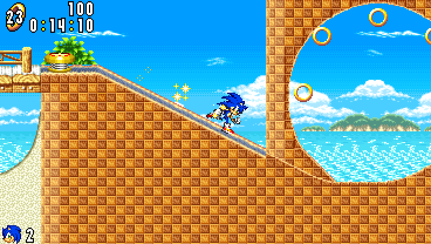</a>

<sub>Neo Green Hill Zone, act 1, in the optional widescreen view. Every clip on this page is a recording of Sonic Advance Dreamport itself.</sub>

<br>

<a href="https://dreamports.net/play/sonic-advance/"></a>

<br>

[What is it?](#what-is-it) &nbsp;·&nbsp; [How to play](#play-in-three-steps) &nbsp;·&nbsp; [Moves](#what-sonic-can-do) &nbsp;·&nbsp; [Extras](#extras-you-can-switch-on) &nbsp;·&nbsp; [Controls](#controls) &nbsp;·&nbsp; [Progress](#where-its-at) &nbsp;·&nbsp; [Questions](#questions)

</div>

<br>

## What is it?

Sonic Advance Dreamport lets you play **Sonic Advance**, Sonic's 2001 adventure for the Game Boy Advance, in a web browser.

It isn't an emulator (a program that imitates a Game Boy Advance). Instead, the game has been rebuilt piece by piece, so that Sonic runs, jumps and rolls the way he does on the cartridge. The pictures, levels, music and sounds come from **your own copy of the game**: you open your Sonic Advance file on the game's page, and Sonic Advance Dreamport reads everything it needs from it, right there on your device.

A *Dreamport* is a port of a game you know, with the extras fans dream of, each one optional. The project was called *Onsoku Advance* until October 2026; *onsoku* (音速) is Japanese for "speed of sound".

<table>
<tr>
<td width="33%" valign="top">

🎮 **True to the original**<br>
Same physics, same timing, same camera and the game's own sound engine, checked against the original game frame by frame.

</td>
<td width="33%" valign="top">

🔒 **Private by design**<br>
Your game file is opened on your device and stays there. Nothing from it is ever uploaded.

</td>
<td width="33%" valign="top">

⚡ **Nothing to install**<br>
Open the page, choose your file and play, with a keyboard, an Xbox controller or on-screen touch buttons.

</td>
</tr>
</table>

## Play in three steps

1. **Open the game** at **[dreamports.net/play/sonic-advance](https://dreamports.net/play/sonic-advance/)** in a current desktop browser.
2. **Add your Sonic Advance file**, the `.gba` file copied from your cartridge (called a *ROM*), with its *Add* button, or drop it anywhere on the page. Sonic Advance 2 and Sonic Rush, below it, are for the optional [extras](#extras-you-can-switch-on). With *Remember on this device* ticked, they are ready the next time too.
3. **Press Play.** The [controls](#controls) are below, and <kbd>H</kbd> shows them during the game.

*Back to dreamports*, at the top of the start screen, goes back to the [dreamports.net](https://dreamports.net/) menu.

> [!TIP]
> **Where does the file come from?** From a Sonic Advance cartridge you own, copied to your computer with a cartridge reader. This project can't provide the game. Sonic Advance (USA) is the tested version; [docs/ROM.md](docs/ROM.md) has the details.

## What Sonic can do

All of this works today. Each clip was played and recorded in Sonic Advance Dreamport, in Neo Green Hill Zone act 1.

<table>
<tr>
<td width="50%" valign="top">
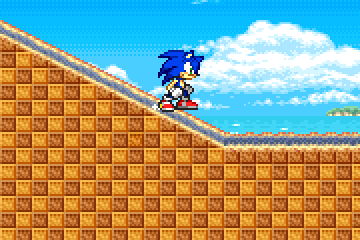
<br>
<b>Spin dash</b><br>
Crouch, rev up and let go to blast off from a standstill.<br>
<kbd>↓</kbd> + <kbd>Z</kbd>
</td>
<td width="50%" valign="top">
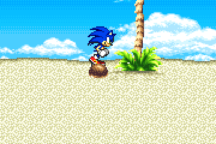
<br>
<b>Insta-shield and mid-air dash</b><br>
Press jump again in the air for a flash of shield, or tap a direction twice to dash.<br>
<kbd>Z</kbd> in the air &nbsp;·&nbsp; <kbd>→</kbd> <kbd>→</kbd> in the air
</td>
</tr>
<tr>
<td width="50%" valign="top">
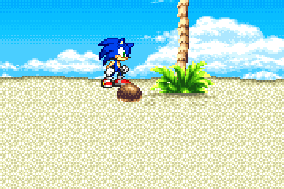
<br>
<b>Spin, kick, then slide or backflip</b><br>
The attack button chains three moves together on the ground.<br>
<kbd>X</kbd> <kbd>X</kbd> then <kbd>X</kbd> or <kbd>Z</kbd>
</td>
<td width="50%" valign="top">
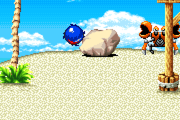
<br>
<b>Bop the robots</b><br>
Land on an enemy to break it open and free the animal trapped inside.<br>
<kbd>Z</kbd> to jump on it
</td>
</tr>
<tr>
<td width="50%" valign="top">
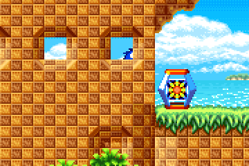
<br>
<b>Item boxes</b><br>
Break one open for rings, a shield, invincibility, speed shoes or an extra life.<br>
<kbd>↓</kbd> while running to roll into it
</td>
<td width="50%" valign="top">
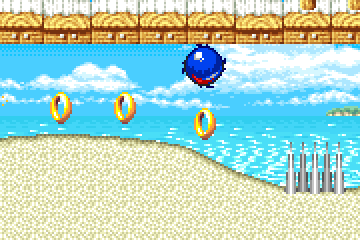
<br>
<b>Rings</b><br>
Collect them as you run. Take a hit and they scatter, so grab what you can. 100 rings earn an extra life.
</td>
</tr>
<tr>
<td width="50%" valign="top">
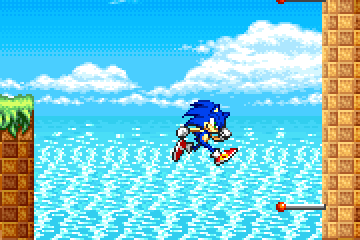
<br>
<b>Wall poles</b><br>
Grab a pole on a cliff face and get swung up to the next one.
</td>
<td width="50%" valign="top">
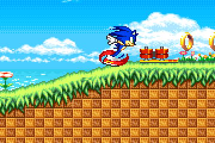
<br>
<b>Half-pipe</b><br>
Hit it at speed and Sonic races up and around its curved wall.
</td>
</tr>
</table>

Act 1 also has its loops, springs, spikes, grind rails, speed boosters, checkpoints, a trampoline, swinging, falling and crumbling platforms, bounce blocks, boulders, waterfalls, an incline ramp and a forced slide, all working as in the original.

## True to the cartridge

<div align="center">

</div>

The goal is a game that behaves *exactly* like the original, not one that looks roughly like it.

- **Rules from the source.** Sonic's speed, jumps and rolls, the camera and every object follow the original game's rules, as worked out by [SAT-R](https://github.com/SAT-R), the community project that turned Sonic Advance's program back into readable code.
- **Checked against the real thing.** The results are compared with the original game running in an emulator. Even the original's own bugs are kept, so the two match; they are [listed](https://github.com/NahuelGenchi/sonic-advance-dreamport/issues/56) for an optional fix later.
- **The game's own sound.** The music and sound effects are played by a rebuilt copy of the cartridge's sound engine, whose output matches the original's byte for byte.
- **Sharp pixels.** The game draws at the Game Boy Advance's own 240 × 160 and scales up in whole steps, so every pixel stays crisp on any screen.

The game opens as the original does, with the SEGA and Sonic Team logos, the intro timed to its music, the title screen and the main menu. Game Start goes straight to the act, where the character select would start; the menu's other modes are next.

The act opens, and starts over after a lost life, with the original title card sliding in as the screen fades up from black. The original on-screen counters show your rings, score, time and lives. Let the clock reach 10:00 and Sonic is out of time: he loses a life, *TIME OVER* slides in and the act starts over (Egg Rocket's five-minute countdown runs out the same way). Lose your last life and it's **game over**; with a continue left, the continue screen counts down from 9: press jump to play the act again with three lives, or attack to count down faster.

## Extras you can switch on

Four optional additions on top of the original game. All are off until you turn them on, and with them off the game runs exactly as without them.

### Widescreen view

<div align="center">
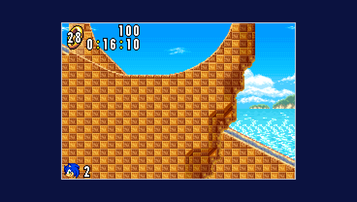
</div>

See more of the act around the original screen, up to 368 × 208, filling the window at the same whole-step scale. The outline marks the Game Boy Advance's screen: the game plays exactly as it does there. Press <kbd>V</kbd> or use the *Widescreen* button in the help panel.

Past the original screen, the view only shows what the game really has there. In an act that is more of the act, as far as the original's camera can go: the view stays inside the act's edges and inside a boss's arena. Where the original has nothing more to show, the view is black, like the frame around the Game Boy Advance's screen: beside an arena narrower than the view, and either side of a screen made for 240 × 160 alone. A picture's edge is never stretched or repeated to fill the space.

### Sonic Rush boost

<div align="center">
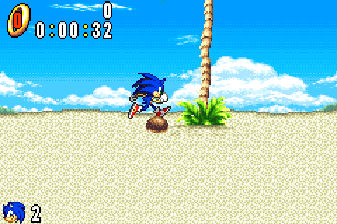
</div>

The boost from *Sonic Rush* on the Nintendo DS. Hold the boost button and Sonic blasts ahead at top speed, wrapped in Rush's blue aura and trail, smashing enemies, boulders and item boxes on contact, while nothing can hurt him. Press <kbd>R</kbd> or use the *Rush boost* button to turn it on, then hold <kbd>L</kbd> or <kbd>Shift</kbd> (<kbd>X</kbd> on a controller) to boost.

Its look and sound are Sonic Rush's own, so it also needs your **Sonic Rush ROM** (`.nds`). Add it on the start screen, next to Sonic Rush, which turns the boost on, or it's asked for the first time you turn the boost on in the game. Like the Sonic Advance file, it's read and kept on your device only. Its rules were read from Sonic Rush (USA) and checked in an emulator. For now it has no limit: Sonic Rush's tension gauge, which the boost uses up, isn't built yet.

<details>
<summary><b>How the boost works, in detail</b></summary>
<br>

- **Start.** Press the boost button while standing or running on the ground (not curled up, attacking or on a
  grind rail). Sonic turns to the direction held and runs at least 12 px a frame that way at once, with Sonic
  Rush's boost sound and a short screen shake.
- **While held.** Rush's own movement rules replace Sonic Advance's: on the ground the top speed is 12, a little
  more on slopes, with an acceleration of 48/256 that fades out as he nears it; holding the other way brakes by
  80/256, and holding nothing slows him by 80/256 on floors. He keeps boosting through jumps, where holding a
  direction keeps his speed with no air drag and holding nothing slows him down. A box 64 px square around him
  destroys enemies and breaks boulders and item boxes, without bouncing him, and shakes the screen each time;
  nothing can hurt him.
- **End.** Letting go of the button ends it, and so does moving less than 6 px a frame on the ground for more
  than 8 frames in a row (running into a wall, say). The next boost can start 8 frames later. Afterwards the
  original rules take over, so he keeps the speed he has until he slows down.
- **Camera.** As in Sonic Rush, the view falls behind him for the first 8 frames, then moves ahead of him by up
  to 88 px in the direction he runs, and eases back once the boost is over.
- **Look.** The burst at the start, the aura around Sonic and the blue trail behind him are Sonic Rush's, from
  its sprites and its trail effect, placed, rotated, layered and blended the way the DS draws them: the sprites
  through its rotation hardware and half transparent, the trail as translucent 3D polygons under them.
- **Sound.** The boost's sound effect is played from Sonic Rush's sound archive by a port of the DS sound engine
  (the sequencer, its channels and the sound hardware), which matches Sonic Rush in an emulator frame by frame.
  It plays on top of the original game's sound at the same full volume, the two consoles' outputs matched.

Where the port differs from the DS: the trail's polygons are not clipped at the screen's edges before they are
drawn, and Sonic Advance's own sprites behind Sonic count as background when the boost's sprites blend over them.

</details>

### Sonic Advance 2 Boost Mode

Boost Mode from *Sonic Advance 2*. Keep running flat out and Sonic breaks into an even faster run, with a burst of sparks and a trail of afterimages in Sonic Advance 2's light-blue boost colours. The more rings he carries, the sooner it kicks in; a hit, or slowing down, ends it. Press <kbd>B</kbd> or use the *Boost Mode* button in the help panel to turn it on. With the Rush boost on as well, the afterimages also follow Sonic while he boosts.

Its look and sound are Sonic Advance 2's own, so it also needs your **Sonic Advance 2 ROM** (`.gba`). Add it on the start screen, next to Sonic Advance 2, which turns Boost Mode and the tricks on, or it's asked for the first time you turn Boost Mode on in the game. Like the Sonic Advance file, it's read and kept on your device only. Its rules were read from Sonic Advance 2 (USA), with the help of SAT-R's work on that game, and checked in an emulator.

<details>
<summary><b>How Boost Mode works, in detail</b></summary>
<br>

- **Filling up.** Sonic still runs as in Sonic Advance, up to 4.5 px a frame. Holding forward on the ground at
  that speed fills Sonic Advance 2's hidden boost meter, faster the more rings he has: it takes 256 frames (about
  4 seconds) with 10 rings or fewer, 170 with 11 to 49, 120 with 50 to 99, 90 with 100 to 149 and 60 (1 second)
  with 150 or more. Leaving the ground or dropping below that speed empties it.
- **Start.** Once the meter is full, Boost Mode starts with Sonic Advance 2's sound, a burst of sparks that
  spread out ahead of Sonic and then sweep back past him, and the camera falling behind: its sideways speed
  limit drops to 4 px a frame and climbs back to 16 by 1/8 px a frame.
- **In Boost Mode.** Holding forward speeds Sonic up to 12 px a frame, at Sonic Advance 2's rate for the ring
  count (from 8/256 to 18/256 a frame, which speed shoes don't change), and his ground speed is capped at 15. In
  the air he speeds up twice as fast, also up to 12. Braking and friction stay Sonic Advance's.
- **Boosters and springs.** Act 1's boosters, and side springs that throw Sonic faster than 9 px a frame from the
  ground, put him straight into Boost Mode, without the sound or the sparks, as Sonic Advance 2's do.
- **End.** It ends when he slows below 4.5 px a frame on the ground, when he is hurt, and when the act starts
  over.
- **The act's end.** Past the goal, or once a boss is beaten, Sonic runs on his own, so the meter stays empty
  and Boost Mode doesn't start, nor from a booster or a spring. If it was already on, it ends there, with its
  afterimages, so his run to the results is Sonic Advance's own.
- **Afterimages.** While it lasts, three copies of Sonic follow him, each playing his animation as it was 2, 4
  or 6 frames before, in Sonic Advance 2's boost palette, just behind him. Only one of them is drawn each frame,
  in turn, as in Sonic Advance 2. With the [Sonic Rush boost](#sonic-rush-boost) on as well, they also show
  while it is held; it keeps its own rules and doesn't fill the meter.
- **Sound.** The start sound plays from your Sonic Advance 2 ROM on a second copy of the sound engine port, on top
  of Sonic Advance's sound.

Where it differs from Sonic Advance 2: outside Boost Mode's own numbers, Sonic keeps Sonic Advance's running and
animations; the start sound has a sound engine of its own, so it never cuts off one of Sonic Advance's sounds;
and it stops at the act's end, which Sonic Advance 2 never needs, as Sonic brakes to a stop after its goal while
Sonic Advance has him run on at full speed.

</details>

### Sonic Advance 2 tricks

The four mid-air tricks from *Sonic Advance 2*. Once Sonic is in the air, press the trick button (the Game Boy Advance's R) alone for the **Back Star**, a backflip, or with up for the **Hop Jump**, forward for the spinning **Humming Top**, or down for the **Bound**, a dive that bounces him back up off the ground. The Humming Top and the Bound break enemies he touches, and each trick scores 100 points. Press <kbd>T</kbd> or use the *SA2 tricks* button to turn them on, then press <kbd>E</kbd> or <kbd>I</kbd> (<kbd>RB</kbd> on a controller) in the air.

Their moves, pictures and sounds are Sonic Advance 2's own, so they also need your **Sonic Advance 2 ROM** (`.gba`): the one added on the start screen, next to Sonic Advance 2, or asked for the first time you turn them on in the game. Like the Sonic Advance file, it's read and kept on your device only. Their rules were read from Sonic Advance 2 (USA) and checked against it in an emulator, frame by frame.

<details>
<summary><b>How the tricks work, in detail</b></summary>
<br>

- **When.** Once Sonic is in the air: in a jump or a fall, off a spring, a ramp or the end of a grind rail, but
  not while he is hurt, grinding, on the half-pipe or in the forced slide. Sonic Advance 2 only allows them after
  springs, ramps and the like; here they work in any jump. One trick each time he leaves the ground, and not in
  the first 2 to 4 frames after a spring, as in Sonic Advance 2.
- **Wind-up.** The trick starts on the frame after the press. Sonic stops in the air for its wind-up, 12 frames
  for the Hop Jump, 8 for the Humming Top, 2 for the Back Star and 23 for the Bound, with Sonic Advance 2's jump
  and trick sounds (the Bound has none).
- **Hop Jump** (with up). He rises at 6 px a frame, then falls as in a jump.
- **Humming Top** (with the way he faces). He spins forward at 6 px a frame for 45 frames, in Sonic Advance 2's
  spin effect, destroying enemies he touches, then falls.
- **Back Star** (alone or with back). He flips backwards and up, at 5 px a frame back and 3.5 up.
- **Bound** (with down). He dives, from 2 px a frame and faster each frame, leaving afterimages and destroying
  enemies he touches. The ground throws him back up at 6 px a frame, away from its surface, with Sonic Advance 2's
  bounce sound, and he falls as in a jump from the top.
- **Steering.** After the wind-up of the Hop Jump, the Humming Top and the Back Star, left and right steer him as
  in a jump, but he doesn't turn round. The Bound can't be steered until it starts to fall.

Where the port differs from Sonic Advance 2: there, B in the air also starts the Bound, and a side spring on the
ground allows a trick too; here neither does. The tricks' sounds play on their own copy of the sound engine, so
they never take a channel from the music, as they can in Sonic Advance 2. The rules, sprites and sounds are
compared with the original in [docs/ROM.md](docs/ROM.md#sonic-advance-2-tricks).

</details>

## Controls

| | Keyboard | Xbox controller |
| :--- | :--- | :--- |
| **Run** | <kbd>←</kbd> <kbd>→</kbd> or <kbd>A</kbd> <kbd>D</kbd> | D-pad or left stick |
| **Jump** | <kbd>Z</kbd> or <kbd>Space</kbd> | <kbd>A</kbd> |
| **Insta-shield** | <kbd>Z</kbd> again in a jump, once the rise slows | <kbd>A</kbd> again |
| **Mid-air dash** | Tap <kbd>←</kbd> <kbd>←</kbd> or <kbd>→</kbd> <kbd>→</kbd> in a jump | Tap left twice or right twice |
| **Attack:** spin, then kick, then slide or backflip | <kbd>X</kbd>, <kbd>X</kbd>, then <kbd>X</kbd> or <kbd>Z</kbd> | <kbd>B</kbd> or <kbd>X</kbd> (only <kbd>B</kbd> with the Rush boost on), again, then again or <kbd>A</kbd> |
| **Crouch**, or **roll** while moving | <kbd>↓</kbd> | Down |
| **Spin dash** | <kbd>↓</kbd> + <kbd>Z</kbd> | Down + <kbd>A</kbd> |
| **Look up** | <kbd>↑</kbd> | Up |
| **Boost**, with the [Rush boost](#sonic-rush-boost) on | <kbd>L</kbd> or <kbd>Shift</kbd> | <kbd>X</kbd> |
| **Trick**, with the [SA2 tricks](#sonic-advance-2-tricks) on, in the air: alone or back for the Back Star, with up the Hop Jump, forward the Humming Top, down the Bound | <kbd>E</kbd> or <kbd>I</kbd> | <kbd>RB</kbd> |
| **Start**: skips the intro, as jump and attack do, opens the menu from the title screen, and pauses the act or the special stage and goes on again | <kbd>Enter</kbd> | <kbd>Menu</kbd> |
| **In the menu:** choose, then pick | <kbd>↑</kbd> <kbd>↓</kbd>, then <kbd>Z</kbd> or <kbd>Space</kbd> | D-pad or left stick, then <kbd>A</kbd> |
| **Continue screen:** continue, or skip to the next number | <kbd>Z</kbd> or <kbd>Space</kbd>, or <kbd>X</kbd> | <kbd>A</kbd>, or <kbd>B</kbd> or <kbd>X</kbd> |
| **Select** | <kbd>Backspace</kbd> | <kbd>View</kbd> |
| Help panel on or off | <kbd>H</kbd> | |
| Sound on or off | <kbd>M</kbd> | |
| Widescreen view on or off | <kbd>V</kbd> | |
| Rush boost on or off | <kbd>R</kbd> | |
| Boost Mode on or off | <kbd>B</kbd> | |
| SA2 tricks on or off | <kbd>T</kbd> | |
| Show the collision (for checking the level) | <kbd>C</kbd> | |

Other controllers that your browser maps to the Xbox layout work the same way. Press a button once after the page loads so the browser notices the controller; on the start screen, a small controller badge lights up while an Xbox controller is connected, and fades and leaves when it's unplugged. On touch screens, on-screen buttons appear instead.

The start screen works with the controller too: the d-pad or left stick moves between its links, buttons and switches, <kbd>A</kbd> presses the one picked, and <kbd>Menu</kbd> starts the game, like <kbd>Enter</kbd> on the keyboard. Browsers open the file list only from the mouse or the keyboard, so add the ROM files that way, or drop them on the page.

## Multiplayer: Chao Hunt

The original game's Chao Hunt, on its first multiplayer stage, for 2 to 4 players on one computer. Each player gets their own Game Boy Advance screen on the page. Three minutes on the clock, one Chao hidden in the stage: grab it, and knock whoever has it to take it from them. Whoever holds it when time runs out wins.

To play, add `?level=14` to the game's address, for example [dreamports.net/play/sonic-advance/?level=14](https://dreamports.net/play/sonic-advance/?level=14), and `&players=3` or `&players=4` for more than two. The rules, the stage and its objects, the mystery item boxes, the music and the results screen are the original's, checked against the original running on linked emulators ([docs/ROM.md](docs/ROM.md#multiplayer-chao-hunt) has the details).

| | Player 1 | Player 2 | Players 3 and 4 |
| :--- | :--- | :--- | :--- |
| **Run**, crouch, look up | <kbd>W</kbd> <kbd>A</kbd> <kbd>S</kbd> <kbd>D</kbd> | <kbd>←</kbd> <kbd>→</kbd> <kbd>↑</kbd> <kbd>↓</kbd> | D-pad or left stick |
| **Jump**, and go on from the results | <kbd>F</kbd> | <kbd>.</kbd> | <kbd>A</kbd> |
| **Attack** | <kbd>G</kbd> | <kbd>/</kbd> | <kbd>B</kbd> or <kbd>X</kbd> |

Players 1 and 2 share the keyboard. Controllers go to the players without keys first: with 3 or 4 players, the first controller is player 3's and the second player 4's, and any more go to players 1 and 2. With 2 players, the first controller is player 1's and the second player 2's. <kbd>H</kbd> and <kbd>M</kbd> work as usual; the widescreen view and the Rush boost are for single player only.

For now everyone plays Sonic, which the original doesn't allow. The results screen leaves out the players' names, which the original takes from each cartridge's save. The other three stages, the screen after the results and the original's menus for setting up a game aren't built yet. For testing, `&seed=` sets the random number the players share at the start and `&chao=` (0 to 7) which of the stage's eight places the Chao starts at.

## Where it's at

> [!NOTE]
> **Early days: the first eight zones are playable.** The game opens with the original [SEGA and Sonic Team logos and the intro](https://github.com/NahuelGenchi/sonic-advance-dreamport/issues/67) and its [title screen and main menu](https://github.com/NahuelGenchi/sonic-advance-dreamport/issues/70). You can play all of **Neo Green Hill Zone act 1**, with its music, sounds, rings, enemies, item boxes and every one of its gadgets, through to its goal signpost and score tally, and then **act 2** with its mini loops, water bridge, bushes and hiding spikes, through to its boss, the Egg Hammer Tank, and the capsule that frees the animals and ends the zone. Seven acts have a special spring, each leading to one of the [seven special stages](https://github.com/NahuelGenchi/sonic-advance-dreamport/issues/132), with its Chaos Emerald and the results, then back to the act. After the capsule the game goes on into **Secret Base Zone**: act 1 with its spotlights, enemies and gadgets, through to its goal, and act 2 with its steam exhausts, hooks, swing ropes and crane claws, through to its boss, the Egg Press. Then comes **Casino Paradise Zone**: act 1 with its pinball tubes, bumpers, flippers and balloons, and act 2 with its carousels, bowls and ship swings, through to its boss, the Egg Ball. After it comes **Ice Mountain Zone**: act 1 with its water, air bubbles and drowning, its snow, enemies and gadgets, and act 2 with its ferris wheels, blocks of ice and underwater lava, through to its boss, the Egg Spider. Then **Angel Island Zone**: act 1 with its lava, rolling boulders, whirlwinds and run wheels, through to its goal, and act 2 with its tubes, hang bars and spiked platforms, through to its boss, Mecha Knuckles. Then **Egg Rocket Zone**, with its launch, stage separations and countdown, up the rocket, and **Cosmic Angel Zone**, with its flipped gravity, tubes, Mirrors and antigravity units, through to its boss, the Egg Snake. After it comes **X Zone**, with its falling bricks and its three bosses one after the other, the Egg Wrecker, the Egg Drillster and Egg X, through to its results. With all seven Chaos Emeralds, X Zone leads on to **the Moon Zone**, the extra stage, with Super Sonic against the Super Egg Robo and the true ending after it; `?level=13` goes straight to it. Start pauses the act and the special stages with the original pause menu, and goes on again where it stopped, music included. Running out of time brings the original *TIME OVER* screen, and losing your last life the original game over and, with a continue left, the continue screen. Without all seven, X Zone's results lead to the normal ending, with the staff credits and the closing message, and the Moon Zone's true ending goes on to the staff credits too. Your progress goes into the original's save, kept in your browser (see [Questions](#questions)). The first stage of [Chao Hunt](#multiplayer-chao-hunt), for 2 to 4 players, is in too: add `?level=14` to the address.

Here's the road through the rest of the game. Each step has its own issue, so you can follow along.

<table>
<thead>
<tr><th align="left">Zone</th><th align="left">Act 1</th><th align="left">Act 2 and boss</th></tr>
</thead>
<tbody>
<tr><td><b>Neo Green Hill</b></td><td>🟢 Playable now, through its ending</td><td>🟢 Playable now, through the Egg Hammer Tank</td></tr>
<tr><td><b>Secret Base</b></td><td>🟢 Playable now, through its goal</td><td>🟢 Playable now, through the Egg Press</td></tr>
<tr><td><b>Casino Paradise</b></td><td>🟢 Playable now</td><td>🟢 Playable now, through the Egg Ball</td></tr>
<tr><td><b>Ice Mountain</b></td><td>🟢 Playable now</td><td>🟢 Playable now, through the Egg Spider</td></tr>
<tr><td><b>Angel Island</b></td><td>🟢 Playable now, through its goal</td><td>🟢 Playable now, through Mecha Knuckles</td></tr>
<tr><td><b>Egg Rocket</b></td><td colspan="2">🟢 Playable now, at <code>?level=10</code><br><sub><a href="docs/egg-rocket.md">What it reads from the ROM</a></sub></td></tr>
<tr><td><b>Cosmic Angel</b></td><td colspan="2">🟢 Playable now, through the Egg Snake<br><sub><a href="docs/cosmic-angel.md">What it reads from the ROM</a></sub></td></tr>
<tr><td><b>X Zone</b></td><td colspan="2">🟢 Playable now, through its three bosses, the normal ending and the staff credits</td></tr>
<tr><td><b>Moon Zone</b></td><td colspan="2">🟢 Playable now, after X Zone with all seven Chaos Emeralds, through the Super Egg Robo, the true ending and the staff credits; <code>?level=13</code> goes straight to it</td></tr>
<tr><td><b>Special stages</b></td><td colspan="2">🟢 All seven, from the special springs in Neo Green Hill act 1, Secret Base act 2, Casino Paradise act 1, Ice Mountain acts 1 and 2, Angel Island act 2 and Cosmic Angel</td></tr>
</tbody>
</table>

Also on the way: the title screen's demos, the character select and the menu's other modes, and the other three [Chao Hunt](#multiplayer-chao-hunt) stages.

<details>
<summary><b>Milestones</b></summary>
<br>

| Milestone | Outcome | Issues closed |
| :--- | :--- | :--- |
| [M0 — Project foundation](https://github.com/NahuelGenchi/sonic-advance-dreamport/milestone/1) | Repository, documentation, tracking and presentation |  |
| [M1 — Playable prototype](https://github.com/NahuelGenchi/sonic-advance-dreamport/milestone/2) | Sonic on a Neo Green Hill platform, assets from your own ROM |  |
| [M2 — Stages and gameplay](https://github.com/NahuelGenchi/sonic-advance-dreamport/milestone/3) | Full stages with collision, rings, objects, enemies, sound and music |  |
| [M3 — Release](https://github.com/NahuelGenchi/sonic-advance-dreamport/milestone/4) | A hosted build and versioned releases, with no game files |  |

The game is [live at dreamports.net](https://dreamports.net/play/sonic-advance/); versioned releases are planned.

</details>

## Questions

<details>
<summary><b>Is this an emulator?</b></summary>
<br>

No. An emulator imitates the Game Boy Advance and runs the cartridge's original program. Sonic Advance Dreamport never runs that program: the game's rules have been written again from scratch in JavaScript, the language of web pages, and only the pictures, levels, music and sounds are read from your copy of the game.

</details>

<details>
<summary><b>Where do I get a Sonic Advance ROM?</b></summary>
<br>

From a Sonic Advance cartridge you own, copied to your computer with a cartridge reader (this is often called *dumping* it). This project doesn't provide the game and can't point you to copies of it.

</details>

<details>
<summary><b>Is my game file uploaded anywhere?</b></summary>
<br>

No. The page reads it inside your browser and never sends it anywhere. If you tick *Remember on this device*, they're kept in your browser's storage on that device only, and *Forget the saved ROMs* on the start screen removes them again. That covers the Sonic Advance 2 and Sonic Rush ROMs too.

</details>

<details>
<summary><b>What does it keep on my device?</b></summary>
<br>

The game's save, the same one the cartridge keeps: the acts you've cleared, the Chaos Emeralds you've won, the rings banked for the Tiny Chao Garden, a best score and the game's settings. It's written at the same moments as on the cartridge: as each act's results end, as a game over ends, and before the endings. So a Chaos Emerald counts as kept once the next act's results are over. The screens that use the rest of the save, such as the course select and the options, aren't built yet.

Besides the save, it remembers which extras you've switched on and whether the widescreen view is on, and keeps your ROMs if you tick *Remember on this device*. All of it stays in your browser's storage for this site, on this device, and is never sent anywhere. Clearing the site's data in your browser removes it. If your browser blocks the site's storage, as some private windows do, the game still plays, but forgets the save when you close the page.

</details>

<details>
<summary><b>Which version of Sonic Advance works?</b></summary>
<br>

**Sonic Advance (USA)** is the tested version. Other versions are recognized from their cartridge header, and the game searches them for what it needs; the [asset viewer](https://dreamports.net/play/sonic-advance/viewer) shows whether that worked. [docs/ROM.md](docs/ROM.md) has the list and how to help add a version.

</details>

<details>
<summary><b>Can I play on a phone or tablet?</b></summary>
<br>

It's made for a current desktop browser, with a keyboard or a controller. On touch screens, on-screen buttons appear so you can play by touch.

</details>

<details>
<summary><b>Is there sound?</b></summary>
<br>

Yes: the intro's music, SEGA's ring at the Sonic Team logo, the title screen's music, the menu's sounds, the act's music, the extra-life and invincibility tunes, and the sound effects of Sonic, the rings, the enemies, the item boxes and the act's springs, platforms, boosters, rails and more, all read from your ROM. <kbd>M</kbd> turns the sound on or off.

</details>

<details>
<summary><b>Is this official?</b></summary>
<br>

No. It's an unofficial fan project, not affiliated with or endorsed by SEGA or Sonic Team. See [Legal](#legal).

</details>

## How it works

For the curious: the path from your ROM to the screen and speakers.


1. **Extract.** You add your ROMs. The extractor locates the game's sprite and tilemap tables and decodes frames, palettes, tiles and animation scripts into memory, entirely in the browser.
2. **Simulate.** The engine steps 60 times per second with the original game's rules: acceleration, braking, gravity, jump height, roll friction, spin dash speeds and the camera's dead zones. On a screen within 1% of 60 Hz every refresh shows the next step (within 1% of 120 Hz, every second refresh), so no step is shown twice or skipped; on other screens the steps follow the clock.
3. **Draw.** The logos, the intro, the title screen and the menu run on a port of the original's own engine (its tasks, sprites, backgrounds, line-by-line effects and V-blank) at the GBA's 59.73 frames a second, and a model of the GBA's video hardware draws them as mGBA does. In the act, sprites and layers are composed at the Game Boy Advance's own 240 × 160 resolution, including the per-line background scrolling the original uses for its sea and clouds. The widescreen view draws up to 368 × 208 around the same screen; the game runs exactly as it does at 240 × 160. The optional [Sonic Rush boost](#sonic-rush-boost) adds its trail and aura around Sonic, the optional [Boost Mode](#sonic-advance-2-boost-mode) Sonic Advance 2's afterimages and sparks, and the optional [Sonic Advance 2 tricks](#sonic-advance-2-tricks) draw Sonic from Sonic Advance 2's sprites while he does one.
4. **Play.** A port of the game's sound engine runs on its own audio thread. It reads the songs and samples from your ROM, and its mixed output matches the original's byte for byte (see [docs/ROM.md](docs/ROM.md#sound)). The Rush boost's sound plays from your Sonic Rush ROM on a port of the Nintendo DS's sound engine, and Boost Mode's and the tricks' from your Sonic Advance 2 ROM on a second copy of the Game Boy Advance one, all added to the same output.

## Run it on your own computer

There is no build step. The pages use JavaScript modules, which browsers only load over HTTP, so serve the repository folder with any static file server and open it on `localhost`:

```sh
git clone https://github.com/NahuelGenchi/sonic-advance-dreamport.git
cd sonic-advance-dreamport
python -m http.server 8000
```

Then open <http://localhost:8000>, add your ROMs and press *Play*. To start another act, add its number in the game's level list: <http://localhost:8000/?level=2> is Secret Base Zone act 1.

Two addresses skip ahead for testing: <http://localhost:8000/?debug> starts the act straight away, without the logos and the intro, and <http://localhost:8000/?special> starts Special Stage 1 as soon as the ROM is read, as if Sonic had just left act 1 on its special spring. When the stage ends, the act picks up again from that spring. With the level of another act that has a special spring it starts that act's stage instead: <http://localhost:8000/?special&level=3> is Special Stage 2, from Secret Base Zone act 2.

To see everything the extractor decodes, open <http://localhost:8000/viewer.html>: Sonic's, the springs' and the rings' animations playing with their original timing, the sprite atlas, Neo Green Hill Zone act 1 with its collision, and the zone's background.

[`wrangler.jsonc`](wrangler.jsonc) sets up the copy that Cloudflare serves at `dreamports.net/play/sonic-advance/`. Its build copies only the committed pages, `src/`, `styles/` and the social preview picture into `dist/play/sonic-advance/`. To try that copy on your computer, commit your changes, run `npx wrangler dev` and open <http://localhost:8787/play/sonic-advance/>.

## Contributing

Every change follows one trail: **issue → branch → milestone → pull request**.

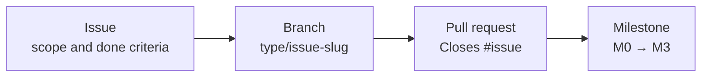

Read [CONTRIBUTING.md](CONTRIBUTING.md) and [docs/TRACKING.md](docs/TRACKING.md) before opening work. Bugs and ideas start as an [issue](https://github.com/NahuelGenchi/sonic-advance-dreamport/issues/new/choose). Never attach ROMs, save files or extracted game assets.

## Thanks

- The [SAT-R](https://github.com/SAT-R) decompilation of Sonic Advance, the reference for the game's data formats, physics and camera behavior. None of its code or data is copied into this repository.
- [Monocraft](https://github.com/IdreesInc/Monocraft) by Idrees Hassan, the pixel font of the start screen. A subset of it is bundled under the SIL Open Font License 1.1 ([styles/fonts/Monocraft-OFL.txt](styles/fonts/Monocraft-OFL.txt)).
- [Pixelarticons](https://github.com/halfmage/pixelarticons) by Gerrit Halfmann, whose gamepad icon is the start screen's controller badge, under the MIT License ([styles/icons/pixelarticons-LICENSE.txt](styles/icons/pixelarticons-LICENSE.txt)).

## Legal

Sonic Advance Dreamport is an unofficial fan project and is not affiliated with or endorsed by SEGA or Sonic Team. Sonic Advance, Sonic Advance 2, Sonic Rush and all related names, characters and artwork belong to SEGA.

This repository holds no ROM and no data taken from one: you need your own legally obtained copy of the game, and its graphics and sounds are read from it on your own device. The short clips on this page (in [docs/assets/gameplay](docs/assets/gameplay)) are recordings of Sonic Advance Dreamport running, made to show the project; the characters and artwork in them remain SEGA's.

The project's own code, documentation and artwork are licensed under [GPL-3.0-or-later](LICENSE).

<br>

<div align="center">
<sub>Built by <a href="https://github.com/NahuelGenchi">Nahuel Genchi</a> &nbsp;·&nbsp; 音速</sub>
</div>
