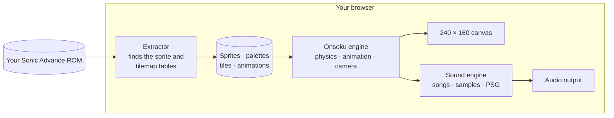
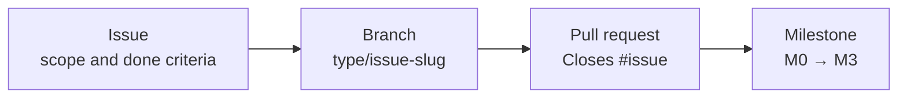

<div align="center">

# Onsoku Advance

**A from-scratch front-end port of Sonic Advance for the Game Boy Advance.**<br>
No emulator and no game files in this repository: your own ROM, read on your machine, brought to life in the browser.

<br>

[](#status)
[](#how-it-works)
[](#how-it-works)
[](#getting-started)
[](LICENSE)

<br>

### [▶ Play in your browser](https://nahuelgenchi.github.io/onsoku-advance/)

<sub>Bring your own Sonic Advance ROM: it is read on your device and never uploaded.</sub>

<br>

[Overview](#overview) &nbsp;·&nbsp; [Status](#status) &nbsp;·&nbsp; [How it works](#how-it-works) &nbsp;·&nbsp; [Getting started](#getting-started) &nbsp;·&nbsp; [Roadmap](#roadmap) &nbsp;·&nbsp; [Contributing](#contributing) &nbsp;·&nbsp; [Legal](#legal)

</div>

<br>

## Overview

*Onsoku* (音速) is Japanese for **"speed of sound"**. Onsoku Advance rebuilds Sonic Advance as a modern web app: the game logic is written from scratch in JavaScript and drawn on a canvas, while the graphics, palettes, level data, music and sounds come from the ROM you own, decoded on your machine.

<table>
<tr>
<td width="50%" valign="top">

**⚡ No emulation**<br>
<sub>The original machine code never runs. Movement, animation and camera are reimplemented as plain JavaScript that any modern browser runs natively.</sub>

</td>
<td width="50%" valign="top">

**🎮 Bring your own ROM**<br>
<sub>Nothing from the game is stored here. Sprites, palettes, tiles, songs and samples are read from your own copy, in your browser, and never uploaded.</sub>

</td>
</tr>
<tr>
<td width="50%" valign="top">

**🎯 Faithful by design**<br>
<sub>Physics constants, animation timing and camera rules follow the original game, as documented by the community decompilation. The sound engine is a port of the original's, checked byte for byte against an emulator.</sub>

</td>
<td width="50%" valign="top">

**🔍 Pixel-perfect**<br>
<sub>Native 240 × 160 output, scaled up in whole steps so every pixel stays sharp on any screen. An optional widescreen view shows more of the act around it.</sub>

</td>
</tr>
</table>

## Status

> [!NOTE]
> **Pre-alpha: the first playable prototype is in.** Sonic runs through the whole of Neo Green Hill Zone act 1, read from your ROM with its collision: slopes, walls, ceilings, jump-through ledges and loops, with the original walking, running, braking, turning, crouching, looking up, jumping, rolling and spin dash, his insta-shield, mid-air dash and B-button ground combo, and the original camera. The act's springs, spikes, rings, enemies, item boxes, platforms (swinging, falling and crumbling platforms, the trampoline and the bounce blocks), boulders, waterfalls, speed boosters, checkpoints, wall poles, grind rails, the incline ramp, the half-pipe and the forced slide work as in the original, and the waterfalls and the sea cycle their colours as they do there: enemies can be destroyed for points and freed animals, Sonic pushes against walls and objects and balances at edges, a hit scatters his rings or, without any, costs a life and starts the act over from the last checkpoint, and the boxes give extra lives, rings, both shields, invincibility and speed shoes. The act opens, and starts over, with the original title card sliding in as the screen fades in from black. The original HUD shows the ring count, score, timer and lives, with an extra life and its jingle every 100 rings. The act's music and its sounds play through a port of the game's own sound engine. There is no end of the act yet, and there is no game over.

| Area | State | Tracked in |
| :--- | :--- | :--- |
| ROM extractor: sprites, palettes, tiles | 🟢 Done, see the [asset viewer](#getting-started) | [#4](https://github.com/NahuelGenchi/onsoku-advance/issues/4) |
| Movement, animations and camera | 🟢 Done | [#5](https://github.com/NahuelGenchi/onsoku-advance/issues/5) |
| Stage maps and collision | 🟡 Neo Green Hill act 1 | [M2](https://github.com/NahuelGenchi/onsoku-advance/milestone/3) |
| Rings, objects and enemies | 🟡 Springs, spikes, rings, act 1's enemies, item boxes, platforms, boulders, waterfalls, boosters, checkpoints, wall poles, grind rails, the incline ramp, the half-pipe and the forced slide, with damage, death and the restart | [#46](https://github.com/NahuelGenchi/onsoku-advance/issues/46) |
| HUD | 🟢 Rings, score, timer and lives | [#22](https://github.com/NahuelGenchi/onsoku-advance/issues/22) |
| Sound and music | 🟡 Act 1 music, the 1-up jingle, the invincibility music, and the sounds of Sonic, the springs, the spikes, the rings, the enemies, the item boxes, the crumbling platforms, the trampoline, the boulders, the boosters, the checkpoints, the wall poles, the grind rails and the incline ramp | [#20](https://github.com/NahuelGenchi/onsoku-advance/issues/20) |
| Hosted build | 🟢 Live on [GitHub Pages](https://nahuelgenchi.github.io/onsoku-advance/) | [#12](https://github.com/NahuelGenchi/onsoku-advance/issues/12) |
| Versioned releases | ⚪ Planned | [M3](https://github.com/NahuelGenchi/onsoku-advance/milestone/4) |

## How it works



1. **Extract.** You pick your ROM. The extractor locates the game's sprite and tilemap tables and decodes frames, palettes, tiles and animation scripts into memory. It is designed to run entirely in the browser: the ROM is read locally and nothing is uploaded.
2. **Simulate.** The engine steps 60 times per second with the original game's rules: acceleration, braking, gravity, jump height, roll friction, spin dash speeds and the camera's dead zones.
3. **Draw.** Sprites and layers are composed at the Game Boy Advance's own 240 × 160 resolution, including the per-line background scrolling the original uses for its sea and clouds. The widescreen view, off by default, draws up to 368 × 208 around the same screen and fills the window at the same whole-step scale; the game runs exactly as it does at 240 × 160. The optional [Sonic Rush boost](#sonic-rush-boost) adds a trail and an aura around Sonic while it runs, and the optional [Boost Mode](#sonic-advance-2-boost-mode) adds Sonic Advance 2's afterimages and sparks.
4. **Play.** A port of the game's sound engine runs on its own audio thread. It reads the songs and samples from your ROM, and its mixed output matches the original's byte for byte (see [docs/ROM.md](docs/ROM.md#sound)). The optional Sonic Rush boost's sound effect plays from your Sonic Rush ROM on a port of the Nintendo DS's sound engine, and Boost Mode's from your Sonic Advance 2 ROM on a second copy of the Game Boy Advance one, both added to the same output.

## Getting started

You will need:

- A current desktop browser
- Your own Sonic Advance ROM, dumped from a cartridge you own. Tested versions are listed in [docs/ROM.md](docs/ROM.md).

**Play online:** open <https://nahuelgenchi.github.io/onsoku-advance/> and choose your ROM. The page only reads it in your browser. The [asset viewer](https://nahuelgenchi.github.io/onsoku-advance/viewer.html) is there too.

**Run it locally:** there is no build step. The pages use JavaScript modules, which browsers only load over HTTP, so serve the repository folder with any static file server and open it on `localhost`:

```sh
git clone https://github.com/NahuelGenchi/onsoku-advance.git
cd onsoku-advance
python -m http.server 8000
```

Then open <http://localhost:8000> and choose your ROM to play. Tick *Remember this ROM on this device* to skip that step next time.

To see everything the extractor decodes, open <http://localhost:8000/viewer.html>: Sonic's, the springs' and the rings' animations playing with their original timing, the sprite atlas, Neo Green Hill Zone act 1 with its collision, and the zone's background.

<details open>
<summary><b>Controls</b></summary>
<br>

| Action | Keyboard | Controller |
| :--- | :--- | :--- |
| Run | <kbd>←</kbd> <kbd>→</kbd> or <kbd>A</kbd> <kbd>D</kbd> | D-pad or left stick |
| Jump (A) | <kbd>Z</kbd> or <kbd>Space</kbd> | <kbd>A</kbd> |
| Insta-shield | <kbd>Z</kbd> again in a jump, once the rise slows | <kbd>A</kbd> again |
| Mid-air dash | Tap <kbd>←</kbd> <kbd>←</kbd> or <kbd>→</kbd> <kbd>→</kbd> in a jump | Tap left twice or right twice |
| Attack (B): spin, then kick, then slide or backflip | <kbd>X</kbd>, <kbd>X</kbd>, then <kbd>X</kbd> or <kbd>Z</kbd> | <kbd>B</kbd> or <kbd>X</kbd> (only <kbd>B</kbd> with the Rush boost on), again, then again or <kbd>A</kbd> |
| Boost, with the [Rush boost](#sonic-rush-boost) on | <kbd>L</kbd> or <kbd>Shift</kbd> | <kbd>X</kbd> |
| Crouch, or roll while moving | <kbd>↓</kbd> | Down |
| Spin dash | <kbd>↓</kbd> + <kbd>Z</kbd> | Down + <kbd>A</kbd> |
| Look up | <kbd>↑</kbd> | Up |
| Show or hide the help panel | <kbd>H</kbd> | |
| Show or hide the collision | <kbd>C</kbd> | |
| Sound on or off | <kbd>M</kbd> | |
| Widescreen view on or off | <kbd>V</kbd> | |
| Rush boost on or off | <kbd>R</kbd> | |
| Boost Mode on or off | <kbd>B</kbd> | |

The controller column follows the standard layout of an Xbox controller; other controllers the browser maps to that layout work the same way. Press a button once after the page loads so the browser lists the controller. On touch screens, on-screen buttons appear instead.

</details>

### Sonic Rush boost

An optional extra on top of the original game: Sonic Rush's boost, its rules read from Sonic Rush (USA) for the
Nintendo DS and checked in an emulator. It is off by default; <kbd>R</kbd> or the *Rush boost* button in the help
panel turns it on, and the choice is remembered on the device. With it off, the game runs and draws exactly as
without it. For now it has no limit: Sonic Rush's tension gauge, which the boost uses up, is not built.

Its look and sound are Sonic Rush's own, so it needs your Sonic Rush ROM (`.nds`) as well: it is asked for the first
time the boost is turned on, read in the browser like the Sonic Advance ROM and, like it, kept on this device only.
Nothing from Sonic Rush is in this repository.

- **Start.** Press the boost button while standing or running on the ground (not curled up, attacking or on a
  grind rail). Sonic turns to the direction held and runs at least 12 px a frame that way at once, with Sonic
  Rush's boost sound and a short screen shake.
- **While held.** Rush's own movement rules replace Sonic Advance's: on the ground the top speed is 12, a little
  more on slopes, with an acceleration of 48/256 that fades out as he nears it; holding the other way brakes by
  80/256, and holding nothing slows him by 80/256 on floors. He keeps boosting through jumps, where holding a
  direction keeps his speed with no air drag and holding nothing slows him down. A box 64 px square around him
  destroys enemies and breaks boulders and item boxes, without bouncing him, and shakes the screen each time;
  nothing can hurt him.
- **End.** Letting go of the button ends it, and so does moving less than 6 px a frame on the ground for more
  than 8 frames in a row (running into a wall, say). The next boost can start 8 frames later. Afterwards the
  original rules take over, so he keeps the speed he has until he slows down.
- **Camera.** As in Sonic Rush, the view falls behind him for the first 8 frames, then moves ahead of him by up
  to 88 px in the direction he runs, and eases back once the boost is over.
- **Look.** The burst at the start, the aura around Sonic and the blue trail behind him are Sonic Rush's, from
  its sprites and its trail effect, placed, rotated, layered and blended the way the DS draws them: the sprites
  through its rotation hardware and half transparent, the trail as translucent 3D polygons under them.
- **Sound.** The boost's sound effect is played from Sonic Rush's sound archive by a port of the DS sound engine
  (the sequencer, its channels and the sound hardware), which matches Sonic Rush in an emulator frame by frame.
  It plays on top of the original game's sound at the same full volume, the two consoles' outputs matched.

Where the port differs from the DS: the trail's polygons are not clipped at the screen's edges before they are
drawn, and Sonic Advance's own sprites behind Sonic count as background when the boost's sprites blend over them.

### Sonic Advance 2 Boost Mode

Another optional extra: Sonic Advance 2's Boost Mode and its afterimages, its rules read from Sonic Advance 2 (USA)
with the help of the SAT-R decompilation of that game, and its timing checked in an emulator. It is off by default;
<kbd>B</kbd> or the *Boost Mode* button in the help panel turns it on, and the choice is remembered on the device.
With it off, the game runs and draws exactly as without it.

Its look and sound are Sonic Advance 2's own, so it needs your Sonic Advance 2 ROM (`.gba`) as well: it is asked for
the first time Boost Mode is turned on, read in the browser like the Sonic Advance ROM and, like it, kept on this
device only. Nothing from Sonic Advance 2 is in this repository.

- **Filling up.** Sonic still runs as in Sonic Advance, up to 4.5 px a frame. Holding forward on the ground at
  that speed fills Sonic Advance 2's hidden boost meter, faster the more rings he has: it takes 256 frames (about
  4 seconds) with 10 rings or fewer, 170 with 11 to 49, 120 with 50 to 99, 90 with 100 to 149 and 60 (1 second)
  with 150 or more. Leaving the ground or dropping below that speed empties it.
- **Start.** Once the meter is full, Boost Mode starts with Sonic Advance 2's sound, a burst of sparks that
  spread out ahead of Sonic and then sweep back past him, and the camera falling behind: its sideways speed
  limit drops to 4 px a frame and climbs back to 16 by 1/8 px a frame.
- **In Boost Mode.** Holding forward speeds Sonic up to 12 px a frame, at Sonic Advance 2's rate for the ring
  count (from 8/256 to 18/256 a frame, which speed shoes don't change), and his ground speed is capped at 15. In
  the air he speeds up twice as fast, also up to 12. Braking and friction stay Sonic Advance's.
- **Boosters and springs.** Act 1's boosters, and side springs that throw Sonic faster than 9 px a frame from the
  ground, put him straight into Boost Mode, without the sound or the sparks, as Sonic Advance 2's do.
- **End.** It ends when he slows below 4.5 px a frame on the ground, when he is hurt, and when the act starts
  over.
- **Afterimages.** While it lasts, three copies of Sonic follow him, each playing his animation as it was 2, 4
  or 6 frames before, in Sonic Advance 2's boost palette, just behind him. Only one of them is drawn each frame,
  in turn, as in Sonic Advance 2. With the [Sonic Rush boost](#sonic-rush-boost) on as well, they also show
  while it is held; it keeps its own rules and doesn't fill the meter.
- **Sound.** The start sound plays from your Sonic Advance 2 ROM on a second copy of the sound engine port, on top
  of Sonic Advance's sound.

Where it differs from Sonic Advance 2: outside Boost Mode's own numbers, Sonic keeps Sonic Advance's running and
animations; and the start sound has a sound engine of its own, so it never cuts off one of Sonic Advance's sounds.

## Roadmap

| Milestone | Outcome | Issues closed |
| :--- | :--- | :--- |
| [M0 — Project foundation](https://github.com/NahuelGenchi/onsoku-advance/milestone/1) | Repository, documentation, tracking and presentation |  |
| [M1 — Playable prototype](https://github.com/NahuelGenchi/onsoku-advance/milestone/2) | Sonic on a Neo Green Hill platform, assets from your own ROM |  |
| [M2 — Stages and gameplay](https://github.com/NahuelGenchi/onsoku-advance/milestone/3) | Full stages with collision, rings, objects, enemies, sound and music |  |
| [M3 — Release](https://github.com/NahuelGenchi/onsoku-advance/milestone/4) | A hosted build and versioned releases, with no game files |  |

## Contributing

Every change follows one trail: **issue → branch → milestone → pull request**.



Read [CONTRIBUTING.md](CONTRIBUTING.md) and [docs/TRACKING.md](docs/TRACKING.md) before opening work. Bugs and ideas start as an [issue](https://github.com/NahuelGenchi/onsoku-advance/issues/new/choose). Never attach ROMs, save files or extracted game assets.

## Acknowledgements

- The [SAT-R](https://github.com/SAT-R) decompilation of Sonic Advance, the reference for the game's data formats, physics and camera behavior. None of its code or data is copied into this repository.

## Legal

Onsoku Advance is an unofficial fan project and is not affiliated with or endorsed by SEGA or Sonic Team. Sonic Advance and all related names, characters and assets belong to SEGA. This repository contains no copyrighted game assets: you need your own legally obtained ROM, and its graphics and sounds are extracted locally on your machine.

The project's own code, documentation and artwork are licensed under [GPL-3.0-or-later](LICENSE).

<br>

<div align="center">
<sub>Built by <a href="https://github.com/NahuelGenchi">Nahuel Genchi</a> &nbsp;·&nbsp; 音速</sub>
</div>
